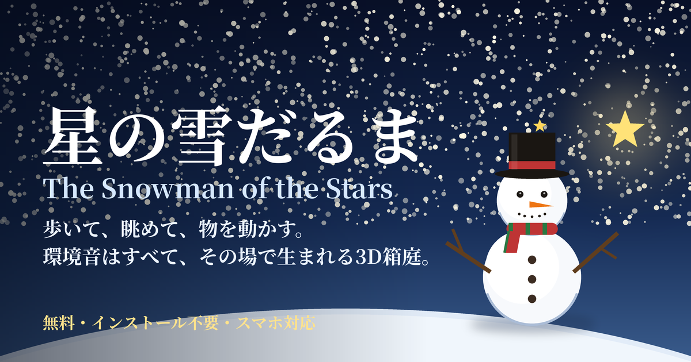

# The Snowman of the Stars — 星の雪だるま

**English** | [日本語](#日本語)

A calm 3D sandbox you can play in your browser: **walk, watch, and rearrange** the natural world where a snowman lives.
The sounds of the river, rain, wind, insects, birds and campfire are not recordings — they are **all synthesized live**.

**▶ Play: https://egoaid.github.io/The-Snowman-of-the-Stars/**

Free, no installation, and works on smartphones. There are no goals or quests. Quiet moments when nothing happens are part of the fun.

## Language
The game starts in **English**. Switch to **日本語** with the "English | 日本語" buttons on the title screen, or in Settings (the "Screen" tab). Your choice is remembered on your device.

## Getting started
1. Open the link above.
2. Choose a **user name** and give your **world** a name.
3. The terrain (hills and a river) is generated automatically. If you don’t like it, press "Regenerate" as many times as you like. When you do, press "Start in this world".
4. Choose how you want to play (a mode).

## Three modes
- **Walk Mode**: walk the snowman yourself and explore. You can pick things up, put them down, and store them in the chest.
- **Watch Mode**: the snowman wanders and lives on its own. Just watch.
- **Edit Mode**: move logs and other things in the world while the snowman wanders. Make Star Shards from stars and attach them to logs, then use **Glue Mode** to glue logs together at the position and angle you choose. Click the golden ring at a glued spot to adjust the angle later or remove the glue. A Moon Shard makes a structure float gently.

## Controls
**Computer**
| Action | Keys |
|---|---|
| Move | W A S D |
| Look | Mouse |
| Jump | Space |
| Run | Shift (while held) |
| Switch view (first / third person) | V |
| Open or close the inventory | E |
| Choose what to hold | 1–9, wheel |
| Act on what you’re aiming at | Left click |
| Stop walking | Esc |

**Smartphone**: left joystick to move, A = jump, B = run, 👝 = inventory, ✦ = act, ✕ at the top right = stop walking.

## A changing world
- Day and night and the seasons follow your real clock and calendar.
- The weather drifts between clear, cloudy, rain, thunderstorm and snow. Snow piles up, and in winter a snow hut appears.
- In autumn the leaves change color and fall.
- In Settings (⚙️ at the top left) you can set the volume of ambient sounds and sound effects separately.

## Saving (users and worlds)
- You can register several users, and **each user can keep several worlds**. Both users and worlds can be deleted later.
- Things you placed, logs you moved, the chest contents, your belongings, the weather and snow, and the snowman’s position are saved automatically. Next time you open the game, you continue where you left off.
- You can export a world (a JSON file) and import it again from the world manager. Use this for backups or to move to another device.
- **Your save data stays only in your browser.** It is never sent to a server. If you clear the browser’s "site data", the saved worlds are deleted too. Export any world you care about.
- The time of day and the season are not saved (the game always starts in sync with your real clock).

## Privacy
No analytics, no ads, no cookies. The names you type and your save data are never sent anywhere.

## On a smartphone
- While you play, the **screen is kept from dimming** (on supported browsers and devices; you can turn it off with "Keep the screen on" in Settings).
- Use the browser menu’s "Add to Home Screen" to launch it like an app. Once opened, it also works offline.
- When a new version is published, a small "New version available" note appears next to the version number.

## Requirements
A recent browser with WebGL and Web Audio (Chrome, Edge, Firefox, Safari). It also runs on smartphones, but may be slow depending on the device. The picture is deliberately drawn at a low resolution and scaled up — the chunky pixels are the look of this world.

## Troubleshooting
- A black screen, or the game fails to load: reload the page. If that doesn’t help, clear the browser’s site data (cache) and open it again. If you want to keep your saves, export your worlds first.
- No sound: press "🔊 Enable sound" in Settings. Some browsers don’t allow sound until you touch the screen.
- "Couldn’t load the saved data": the save data may be damaged or made by a newer version. Reload the page to get the newest version.

## License and what it uses
All rights reserved. © 2026 egoaid (see [LICENSE](LICENSE)).
Rendering uses [three.js](https://threejs.org/) and physics uses [cannon-es](https://github.com/pmndrs/cannon-es) (both MIT licensed). The ambient sounds, sound effects and icons were made for this app.

---

# 日本語

[English](#the-snowman-of-the-stars--星の雪だるま) | **日本語**

雪だるまが暮らす3Dの自然を、**歩いて、眺めて、物を動かして**楽しむ、ブラウザで遊べる箱庭です。
川・雨・風・虫・鳥・焚き火などの環境音は、録音を使わず、**すべてその場で生成**されます。

**▶ 遊ぶ: https://egoaid.github.io/The-Snowman-of-the-Stars/**

無料・インストール不要・スマートフォン対応です。目的もクエストもありません。何も起こらない時間も、この世界の楽しみ方のひとつです。

## 言語
最初は**英語**で始まります。起動画面の「English | 日本語」ボタン、または設定の「がめん」タブで、**日本語**に切り替えられます。選んだ言語は、この端末に覚えておきます。

## はじめかた
1. 上のリンクを開きます。
2. 最初に**ユーザー名**を決めて、**ワールドの名前**を付けます。
3. 地形(起伏と川)が自動で作られます。気に入らなければ「作り直す」で、何度でも作り直せます。気に入ったら「このワールドで始める」を押します。
4. 遊び方(モード)を選びます。

## 3つのモード
- **歩行モード**: 自分で雪だるまを歩かせて、世界をめぐります。物を拾ったり、置いたり、チェストにしまったりできます。
- **見守りモード**: 雪だるまが自分で歩き回って暮らします。ただ眺めるモードです。
- **編集モード**: 雪だるまが歩く世界で、丸太などの物を動かせます。星から星のかけらを作って丸太に貼り、**接着モード**で、位置と角度を決めて丸太どうしを接着できます。接着した所の金色の輪をクリックすると、あとから角度を直したり、接着を外したりできます。月のかけらを貼ると、建造物がふわふわ浮きます。

## 操作方法
**パソコン**
| 操作 | キー |
|---|---|
| 移動 | W A S D |
| 視点 | マウス |
| ジャンプ | Space |
| 走る | Shift(押している間) |
| 視点切替(一人称・三人称) | V |
| 持ち物の開閉 | E |
| 持つ物を選ぶ | 1〜9、ホイール |
| 狙っている物へアクション | 左クリック |
| 歩行モードを終える | Esc |

**スマートフォン**: 画面左のジョイスティックで移動、A=ジャンプ、B=走る、👝=持ち物、✦=アクション、右上の✕=歩行モードを終える。

## 世界の変化
- 昼と夜、季節は、実際の時刻と日付に合わせて変わります。
- 天候は、晴れ・曇り・雨・雷雨・雪がランダムに移り変わります。雪は積もり、冬にはかまくらが建ちます。
- 秋には木の葉が色づき、落ち葉が積もります。
- 設定(画面左上の⚙️)で、環境音と効果音の音量を別々に調整できます。

## 保存(ユーザーとワールド)
- ユーザーは複数登録でき、**ユーザーごとに複数のワールド**を保存できます。ユーザーもワールドも、あとから削除できます。
- 置いた物・動かした丸太・チェストの中身・持ち物・天候と積雪・雪だるまの位置が、自動で保存されます。次に開くと、続きから始まります。
- ワールドの管理画面から、ワールドの書き出し(JSONファイル)と読み込みができます。バックアップや、別の端末への移動に使えます。
- **保存データは、お使いのブラウザの中だけ**に置かれます。サーバーへは送りません。ブラウザの「サイトデータの削除」を行うと、保存データも消えます。大切なワールドは、書き出しておくと安心です。
- 時刻・季節は保存されません(いつも実際の時計に合わせて始まります)。

## プライバシー
アクセス解析・広告・Cookieは使いません。入力した名前や保存データが、外部へ送られることはありません。

## スマートフォンで
- 遊んでいる間、**画面が自動で暗くならない**ようにしています(対応しているブラウザ・端末のみ。設定の「画面をつけたままにする」で切り替えられます)。
- ブラウザのメニューから「ホーム画面に追加」すると、アプリのように起動できます。一度開けば、オフラインでも動きます。
- 新しい版が公開されると、画面のバージョン表記の横に「新しい版があります」と小さく出ます。

## 動作環境
WebGLとWeb Audioが使える、最近のブラウザ(Chrome・Edge・Firefox・Safari)。スマートフォンでも動きますが、端末の性能によっては、動作が重くなることがあります。画面は、あえて低い解像度で描いて拡大しています(ピクセルの粗さは、この世界の見た目です)。

## うまく動かないとき
- 真っ暗なまま、または読み込みに失敗する: ページを再読み込みしてください。それでも直らない場合は、ブラウザのサイトデータ(キャッシュ)を削除してから開き直してください。保存データを残したい場合は、先にワールドを書き出してください。
- 音が出ない: 設定の「🔊 音を有効にする」を押してください。ブラウザの制限で、画面をさわるまで音を出せないことがあります。
- 「保存データを読み込めませんでした」と出る: 保存データが壊れているか、新しい版で作られています。ページを再読み込みして新しい版にしてください。

## ライセンス・使用しているもの
All rights reserved. © 2026 egoaid(詳しくは [LICENSE](LICENSE))。
描画に [three.js](https://threejs.org/)、物理に [cannon-es](https://github.com/pmndrs/cannon-es)(どちらもMITライセンス)を使っています。環境音・効果音・アイコンは、このアプリのために作られたものです。
